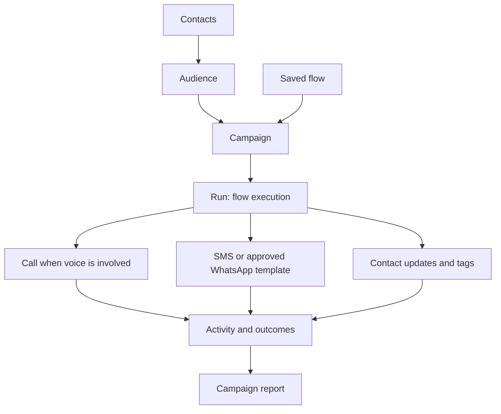
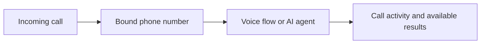

This overview shows the objects you configure and the activity you inspect.

The campaign connects the audience to a saved flow. The run records an execution of that flow. Channel activity depends on the steps reached; every run does not create both a call and a message.

## Other entry points

A flow test or supported API request can start a run without launching a campaign. An inbound binding routes a phone number to a Voice flow or AI agent.

See [How Gomobile works](/product/how-gomobile-works) for the object definitions and [campaign lifecycle](/product/campaign-lifecycle) for enrollment and scheduling.
