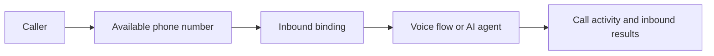

An inbound binding connects an available phone number to one Voice flow or one AI agent. It defines where an incoming call goes; it is separate from an outbound campaign’s audience and schedule.

## Binding history

When a number’s destination changes, binding history separates the reporting periods. Investigate the binding associated with the activity rather than assuming all historical calls used the current destination.

## Before receiving calls

Review the destination, available number, saved flow or agent configuration, credits, and recording requirements. Test with a phone you control.

General phone-number provisioning and binding management are not covered by the current customer machine API. Agent publication is a separately documented supported route where approved.

Next: [AI voice agents](/learn/concepts/agents), [Flows](/learn/concepts/flows), and [Inbound reference](/developers/reference/inbound).
