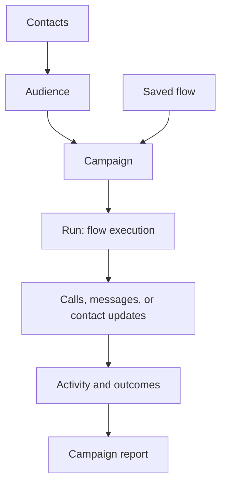

Most Gomobile workflows connect customer data to an automated experience, then produce activity that your team can investigate.

A campaign is the outreach program; a run is a flow execution. These docs use **Campaign** and **Run** to match the Gomobile interface. The flow is saved configuration, while the run records what happened when it executed.

See the [core concepts](/learn/concepts/organizations) and [architecture overview](/learn/architecture) for more detail.

## Core objects

| Object | What it represents | Example |
| --- | --- | --- |
| Contact | One customer identified primarily by phone number, with standard fields and optional custom attributes | Amina El Amrani in Casablanca |
| Audience | The contacts eligible for a campaign | Customers with a renewal date in the next 30 days |
| Flow | The automation Gomobile runs | Confirm an appointment and update the contact's status |
| Campaign | The audience, flow, schedule, channel resources, calling policy, and lifecycle for an outreach operation | October appointment confirmations |
| Run | One execution of a flow for a particular context | The automation created for Amina during the campaign |
| Call | A placed or answered voice interaction associated with a run when voice is involved | The outbound call to Amina |

## Static and live audiences

A **static audience** changes only when someone adds or removes contacts. It works well for a reviewed list, event attendees, or a one-time operational batch.

A **live audience** uses rules. Contacts enter and leave automatically as their data begins or stops matching those rules. Use it for continuously changing segments, such as customers whose renewal date is approaching.

You choose the audience type during creation and cannot switch the type later.

## Voice and multichannel flows

A **Voice flow** defines what happens during a call. The visual builder can play audio, say text, collect keypad input, record a segment, transfer or end the call, branch, connect to an AI agent, update the contact, apply a tag, or send a follow-up message.

A **Multichannel flow** coordinates actions outside a single call. It can branch, update contacts, apply tags, send SMS, send approved WhatsApp templates, and invoke a Voice flow as a sub-flow.

<Note>
  A campaign, flow test, API request, or inbound binding can start a run. Voice flows can connect to an active AI agent. Multichannel flows can invoke Voice sub-flows; Voice flows cannot invoke sub-flows.
</Note>

## Runs, calls, tries, and outcomes

- A **run** records how a flow progressed for one execution context.
- A **call** records a voice interaction and its timeline, result, and associated media when available.
- A **try** is one campaign attempt to reach a contact. Retries create additional tries.
- An **outcome** summarizes what ultimately happened for the contact or interaction.

Use the campaign report to understand the operation as a whole, Runs to investigate automation paths, and Calls to investigate voice details.

## Inbound routing

An **inbound binding** routes an available phone number to one AI agent or one Voice flow. Binding history separates reporting periods when a number's destination changes.

## Credits

A credit is Gomobile's prepaid usage unit. It is not a currency. Eligible users can see the organization balance, while calls, runs, and campaigns show applicable usage and cost breakdowns.

<CardGroup cols={2}>
  <Card title="Tour the workspace" icon="panel-left" href="/getting-started/workspace-tour">
    Find each area in the Gomobile navigation.
  </Card>
  <Card title="Import contacts" icon="file-up" href="/getting-started/import-contacts">
    Start preparing customer data for an audience.
  </Card>
</CardGroup>

## Channels, agents, and workspace resources

- [Voice, SMS, and multichannel](/learn/concepts/channels): choose channel resources and flow types.
- [WhatsApp and templates](/learn/concepts/whatsapp): understand connection state, approval, and sends.
- [AI voice agents](/learn/concepts/agents): distinguish configuration, testing, and publication.
- [Knowledge bases](/learn/concepts/knowledge-bases): prepare documents for compatible agents.
- [Inbound routing](/learn/concepts/inbound): connect incoming calls to a flow or agent.
- [Audio and pronunciation dictionaries](/learn/concepts/audio): prepare reusable voice resources.
- [Calls, outcomes, and reports](/learn/concepts/reporting): investigate activity at the right level.
- [Credits and usage](/learn/concepts/credits): review balance and usage before testing.
- [API keys, access, and security](/learn/concepts/access): understand credentials and workspace access.
